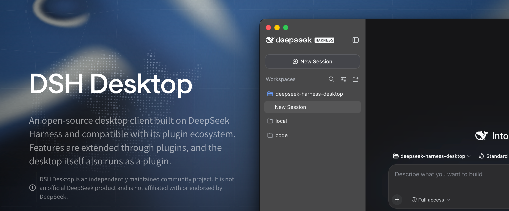
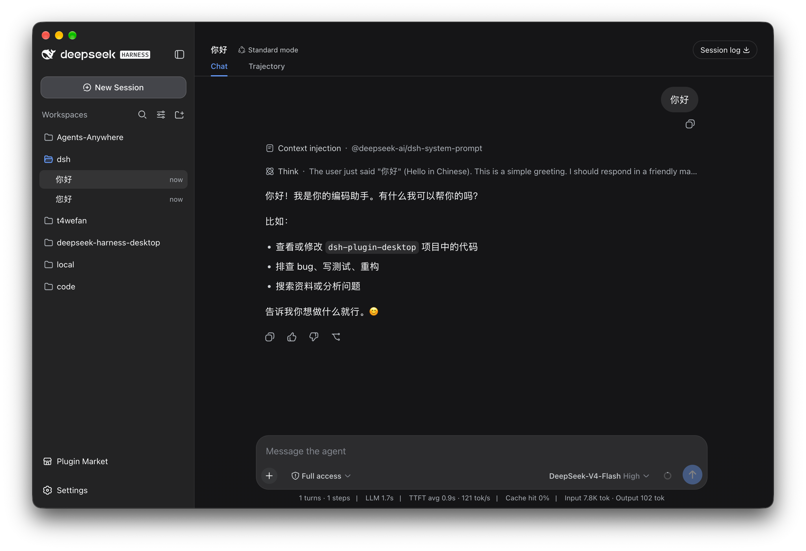

<p align="center">
  <a href="https://omnimux.ai"></a>
</p>

<h1 align="center">OmniMux Desktop</h1>

<p align="center">
  <strong>Your Content Commerce Team — One content commerce system that carries your product's selling points through every video. Use the Agents you already know to create ads, shoppable videos, and product reviews—all in one place.</strong>
</p>

<h3 align="center"><a href="https://omnimux.ai">One-click download, ready to use out of the box.</a></h3>

<p align="center">
  Hand your products and creative ideas to desktop Agents and run the full <strong>Benchmark → Deconstruct → Produce → Publish → Review</strong> loop in one local workspace.<br>
  Everything is a plugin — the desktop itself is a plugin.
</p>

<p align="center"><sub>An independent open-source desktop project, not affiliated with, authorized by, or endorsed by DeepSeek.<br>No DeepSeek employee or official upstream DeepSeek Harness team member currently participates in this repository; upstream contributors shown by GitHub are inherited from synchronized fork history.<br><a href="README.md">中文</a> · English</sub></p>

<p align="center">
  
</p>

<p align="center">
  <a href="https://omnimux.ai"></a>
  <a href="https://github.com/omnimux-ai/omnimux-desktop/releases/latest"></a>
  <a href="https://github.com/omnimux-ai/omnimux-desktop"></a>
  <a href="LICENSE"></a>
  <a href="https://discord.gg/omnimux"></a>
  
</p>

**OmniMux Desktop** is a native desktop workbench for content commerce sellers and creators (supporting macOS Universal and Windows x64), built on the open-source [DeepSeek Harness](https://github.com/deepseek-ai/deepseek-harness), [DSH Desktop](https://github.com/anywhere-labs/deepseek-harness-desktop), and the [Cordis](https://github.com/cordiverse/cordis) plugin architecture. It runs a pinned upstream version unchanged, while OmniMux Desktop provides the window, tray, terminal, updates, and work profiles—composing content commerce workflows with upstream Agent capabilities in a single local runtime.

### Core Content Commerce Workflow

Hand your products and creative direction to desktop Agents and run the full **Benchmark → Deconstruct → Produce → Publish → Review** closed loop in one local workspace:

- **Product & Asset Hub**: Built-in product catalog, AI persona library, and multi-angle asset library that keep your core selling points and brand visuals consistent across every video.
- **Viral Benchmarking & Breakdown**: Deconstruct high-converting ads, shoppable videos, and product review scripts into reusable 3-second hooks, storyboard pacing, and selling-point copy.
- **Infinite Canvas & Timeline Video Editing**: Combine an infinite multimodal Canvas workflow with timeline video editing to generate scripts, voiceovers, visuals, storyboard clips, and finished videos in one place.
- **Multi-Platform Scheduling & Analytics**: Built-in scheduling and publishing center for TikTok, Instagram, Facebook, and YouTube to track performance and feed insights back into your next production cycle.

### OmniMux Open-Source Ecosystem

| Repository | Role |
| --- | --- |
| [`omnimux-ai/omnimux-desktop`](https://github.com/omnimux-ai/omnimux-desktop) | **OmniMux Desktop** workbench (this repository): native macOS Universal and Windows x64 host, window and tray integration, packaging, and distribution |
| [`omnimux-ai/omnimux-dsh`](https://github.com/omnimux-ai/omnimux-dsh) | **OmniMux DSH Plugins**: content commerce workbench, product and asset libraries, canvas workflows, timeline editing, and social publishing plugins |
| [`omnimux-ai/omnimux-gateway`](https://github.com/omnimux-ai/omnimux-gateway) | **OmniMux Gateway**: multimodal model routing, video generation orchestration, accounts, and billing gateway service |

<a id="run"></a>

## Download and install

Current release installers support Windows x64 and macOS Universal (Intel and Apple Silicon). Visit the official website at [https://omnimux.ai](https://omnimux.ai) or download directly from the sole official distribution CDN at `https://dl.omnimux.ai` — no Node.js or command-line setup is needed.

| Platform | Official Download (`dl.omnimux.ai`) | Installation |
| --- | --- | --- |
| macOS Universal | [Download `OmniMux-universal.dmg`](https://dl.omnimux.ai/releases/latest/OmniMux-universal.dmg) | Open the DMG and drag OmniMux into Applications |
| Windows x64 | [Download `OmniMux-Setup.exe`](https://dl.omnimux.ai/releases/latest/OmniMux-Setup.exe) | Run the NSIS installer and follow its prompts |

See the [user guide](docs/user-guide.en.md) and [FAQ](docs/faq.en.md) for plugin commands, platform details, and troubleshooting.

Together with every plugin author, we want to build an open, composable, and sustainable DSH plugin ecosystem where plugins grow alongside each other. Read the [DSH plugin ecosystem manifesto](docs/plugin-ecosystem.en.md).

## Documentation

Ordinary users can start with the [user guide](docs/user-guide.en.md); the developer documentation is only needed when extending or maintaining the application.

### User documentation

| Goal | Entry point |
| --- | --- |
| Install and use the application | [User guide](docs/user-guide.en.md) |
| Check platforms, prerequisites, and product boundaries | [FAQ](docs/faq.en.md) |
| Understand data processing and privacy choices | [Privacy Policy](PRIVACY.md) |
| Understand why the project exists | [Why Desktop](docs/why-desktop.en.md) |
| See the full documentation and README map | [Documentation index](docs/README.en.md) |

### Developer and maintainer documentation

| Goal | Entry point |
| --- | --- |
| Read the plugin ecosystem manifesto | [Plugin ecosystem manifesto](docs/plugin-ecosystem.en.md) |
| Build ordinary or Desktop plugins | [Plugin development](docs/plugin-development.en.md) |
| Join the unified plugin-contract discussion | [DSH Community Fabric Draft](dsh-community-fabric/README.md) |
| See the research behind the unified plugin framework | [Framework and real-plugin research](dsh-community-fabric/docs/research/mature-plugin-frameworks.md) |
| Read the plugin market product and safety design | [DSH Community Market](dsh-community-market/README.md) |
| See what Desktop plugins can use | [Desktop plugin API](dsh-plugin-desktop/docs/plugin-services.md) |
| Understand how the desktop works | [Architecture](docs/architecture.en.md) |
| Read package-level build and release details | [`dsh-plugin-desktop/README.md`](dsh-plugin-desktop/README.md) |

## Features

<table>
  <tr>
    <td width="50%" valign="top">
      <h3>Content Commerce Desktop Workbench</h3>
      <p>Bring the upstream DeepSeek Harness local Web UI and the OmniMux content commerce suite to a native desktop application. The app starts and manages the local Harness service, integrates the product catalog, AI persona asset library, infinite canvas, timeline video editor, and multi-platform publishing center, and requires no Node.js installation or command-line setup.</p>
    </td>
    <td width="50%" valign="top">
      <h3><a href="https://www.agents-anywhere.com">Mobile Remote Control</a> </h3>
      <p>Connect to Desktop from iOS and Android to start tasks, monitor Agent video production and workflow progress, and send follow-ups from your phone. Built in since 2.0.9.</p>
    </td>
  </tr>
  <tr>
    <td width="50%" valign="top">
      <h3><a href="dsh-community-market/README.md">Plugin Marketplace</a> </h3>
      <p>DSH Community Market is complete and built in, with plugin discovery, details, installation, and management. The market openly connects to a wide range of plugin data sources: anyone can provide, integrate, and use a source that follows the public schemas, while existing APIs can join as cooperating sources through a reviewed adapter.</p>
    </td>
    <td width="50%" valign="top">
      <h3>Co-build the Plugin Ecosystem</h3>
      <p>The DSH plugin ecosystem is built by the community. Upstream plugins, OmniMux content commerce plugins, Desktop plugins, and other community plugins follow shared conventions and can work together through the same composition mechanism. Join us — read the <a href="docs/plugin-ecosystem.en.md">DSH plugin ecosystem manifesto</a>.</p>
    </td>
  </tr>
</table>

### First-run setup, browser access, and LAN exposure

On the normal first launch of each uninitialized profile, Desktop shows its native Setup Wizard first. It can configure the window mode and system material, plugin marketplace, notifications, whether to open the system default browser automatically, and the Web access scope; it can also be skipped. The Host and main window do not start until the wizard is completed or skipped. Completion or skip state is recorded separately for each profile; an explicit recovery launch still enters Recovery Assistant first.

The Web service listens on the local loopback interface by default. When **Open in browser** is enabled, Desktop hands the page to the system default browser after the Web service is actually ready; this preference does not change the listener exposure. **Desktop settings** shows the actual local URL below the control. LAN access is a separate opt-in setting and exposes the currently available LAN URLs when enabled.

> **Danger:** LAN exposure has no authentication. Anyone on the same local network can open DSH and directly operate your computer. Enable it only on a fully trusted network and with great care.

The automatic updater's fixed version-check request sends the installed version in the `X-DSH-Desktop-Version` header and a locally generated, persistently stored random UUID in the `X-DSH-Desktop-Installation-Id` header; the value is not derived from hardware information. Package download requests and their download redirects do not receive these headers.

## Plugin Ecosystem

Plugins are extensions that add capabilities to DSH — models, tools, interfaces, and content commerce workflows can all be plugins, combined like building blocks.

OmniMux Desktop does not modify upstream DeepSeek Harness source, and it is not a fixed, hardcoded shell. A pinned upstream DeepSeek Harness version runs unchanged; the desktop shell itself — the window, tray, terminal, updates, and work profiles — along with the OmniMux content commerce suite integrates as DSH plugins through the Cordis plugin mechanism provided by DeepSeek Harness. From the core agent to the desktop shell, the whole product follows the same "everything is a plugin" rule: plugins compatible with the pinned upstream version can be used, while desktop capabilities are composed, replaced, and evolved in the same way.

We want the plugin ecosystem to work like a phone app store: every plugin is built against the same set of rules, so plugins can be installed together and work together without interfering with each other.

### For developers

Unlike many other projects, this project itself is a DSH [plugin](docs/plugin-development.en.md): the desktop shell uses the same plugin composition mechanism as third-party plugins. Desktop plugin capabilities are now available. We provide Desktop services so plugin developers can integrate their plugins with desktop capabilities: for example, viewing and switching work profiles, or installing, updating, and removing plugins in the active profile. See the [Desktop plugin API](dsh-plugin-desktop/docs/plugin-services.md) for complete usage details. See [Why Desktop](docs/why-desktop.en.md) and [Plugin development](docs/plugin-development.en.md) for the reasoning and the third-party boundary.

## Relationship to DeepSeek Harness and DSH Desktop

OmniMux Desktop is an independent open-source desktop project built on [DeepSeek Harness](https://github.com/deepseek-ai/deepseek-harness), [DSH Desktop](https://github.com/anywhere-labs/deepseek-harness-desktop), and the [Cordis](https://github.com/cordiverse/cordis) plugin model, designed to give content commerce sellers and creators an all-in-one desktop workbench — **Your Content Commerce Team**.

This repository is independently maintained by the community and the OmniMux team. No DeepSeek employee or member of the official upstream DeepSeek Harness team currently participates in its development, maintenance, or governance. Contributors from the upstream project may appear on GitHub's Contributors page because this repository inherited and later synchronized upstream commit history when it was forked. Such attribution reflects commit provenance only and does not imply involvement in this repository or any affiliation, partnership, authorization, or endorsement.

The upstream DeepSeek Harness project provides the core agent capabilities, plugin system, and Web UI. Upstream DSH Desktop and OmniMux Desktop primarily provide:

- Native desktop application packaging and preset OmniMux content commerce workspace composition
- Starting, stopping, and recovering the local service
- Desktop window and system tray integration
- macOS Universal and Windows x64 installer builds and distribution via `dl.omnimux.ai`
- An interface tailored for desktop and content commerce production workflows

If you prefer to run DeepSeek Harness from the command line or contribute to its core functionality, refer to the upstream repository first.

## Special Thanks

Special thanks to the [original DeepSeek Harness repository](https://github.com/deepseek-ai/deepseek-harness) and the DeepSeek AI team. OmniMux Desktop is built from a pinned upstream checkout, and its core agents, models, tools, sessions, Web UI, and plugin ecosystem come from that project.

Special thanks to [Anywhere Labs](https://github.com/anywhere-labs) and the [DSH Desktop](https://github.com/anywhere-labs/deepseek-harness-desktop) team for their foundational engineering work on the open-source desktop shell, plugin marketplace (DSH Community Market), and mobile remote control (Agents Anywhere).

We also thank [Cordis](https://github.com/cordiverse/cordis) for the plugin foundation that makes this composition possible. OmniMux Desktop would not exist without these open-source projects.

We are also grateful to the [Koishi.js](https://koishi.chat/) project and community for their long-standing work on plugin practices, tooling, and shared knowledge, and to everyone who contributes discussions, testing, feedback, and plugins.

Also, and you.

<a id="run-from-source"></a>

## Development

Desktop source lives in `dsh-plugin-desktop/` and `dsh-desktop-next/`. The outer repository uses Yarn, while the pinned `deepseek-harness/` submodule keeps its own pnpm workspace. From the repository root:

```sh
git submodule update --init --recursive
corepack yarn install --immutable
corepack yarn dev
```

Use `corepack yarn check` for the headless gate. The [architecture](docs/architecture.en.md) and package [`README`](dsh-plugin-desktop/README.md) describe the full build, test, and release boundaries. See [CONTRIBUTING.en.md](CONTRIBUTING.en.md) for how to contribute.

### macOS microphone permission

Stable, Beta, and Next sign the main application and the Electron Helpers directly with
`deepseek-harness/apps/desktop/scripts/macos-entitlements.plist` from the pinned upstream checkout. After a submodule update, packaging picks up the matching entitlements automatically, so no local copy is maintained; initialize the submodule before packaging. Each edition's macOS configuration keeps its own product-specific microphone usage description.

Voice input triggers system consent through the upstream recording flow. The voice plugin no longer has a separate permission button, and Stable/Beta no longer install a microphone permission request bridge or interceptor.

## Community and Links

- Official Website: [https://omnimux.ai](https://omnimux.ai)
- Official Download CDN: [https://dl.omnimux.ai](https://dl.omnimux.ai)
- GitHub Repositories: [omnimux-ai/omnimux-desktop](https://github.com/omnimux-ai/omnimux-desktop) · [omnimux-ai/omnimux-dsh](https://github.com/omnimux-ai/omnimux-dsh) · [omnimux-ai/omnimux-gateway](https://github.com/omnimux-ai/omnimux-gateway)
- Discord Community: [Join the OmniMux Discord](https://discord.gg/omnimux)

### Related Links (DeepSeek Harness Ecosystem)

Ecosystem projects and developer tools around DeepSeek Harness.

| Project | About | Link |
| --- | --- | --- |
| DSH Desktop | Open-source desktop client for Windows and macOS built on DeepSeek Harness (the upstream desktop foundation of this project). | [GitHub](https://github.com/anywhere-labs/deepseek-harness-desktop) |
| dshfind | The learning & sharing community for DeepSeek Harness (DSH). | [GitHub](https://github.com/hikariming/dshfind) · [Website](https://dshfind.com) |
| DSH 1024Store | Community plugin directory for the DeepSeek Harness (DSH) ecosystem, open-sourcing an online marketplace, a collection pipeline, and a public query API. | [GitHub](https://github.com/imsai-sh/awesome-deepseek-harness-plugins) |
| Awesome DSH Plugin | Curated list of DeepSeek Harness (DSH) plugins. | [GitHub](https://github.com/awesome-dsh-plugin/awesome-dsh-plugin) |
| dsh-market | Visual plugin market for DeepSeek Harness, with browsing, search, and one-click installation. | [GitHub](https://github.com/dsh-market/dsh-market) |
| ModLens | Adds OCR, layout, and semantic vision capabilities to DeepSeek Harness and text-only coding agents. | [GitHub](https://github.com/liustack/modlens) · [Website](https://liustack.dev) |
| DeepSeek Harness Orange Book | Community field manual for DeepSeek Harness. | [GitHub](https://github.com/alchaincyf/deepseek-harness-orange-book) |
| dsh-web-ui | DeepSeek Harness Web UI plugins and themes. | [GitHub](https://github.com/zhu1090093659/dsh-web-ui) · [Gallery](https://gallery.dsh-market.com) |
| dsh-TUI | Full-screen interactive terminal interface for DeepSeek Harness. | [GitHub](https://github.com/ccch1mneyyy/dsh-TUI) |
| dsh-tianshu-tui | Minimalist interactive terminal UI plugin for the DSH web client with a self-developed ANSI rendering core. | [GitHub](https://github.com/huiliyi37/dsh-tianshu-tui) |
| dsh-context | DSH context insight panel: Context dashboard + `/context` command + Context browser. | [GitHub](https://github.com/bowenliang123/dsh-context) · [NPM](https://www.npmjs.com/package/dsh-context) |
| Agents-Anywhere | Remote-control your desktop coding agent from your phone. | [GitHub](https://github.com/anywhere-labs/Agents-Anywhere) |
| deepseek-harness-remote | Remote control and multi-device collaboration plugin for DeepSeek Harness based on P2P and APIProxy. | [GitHub](https://github.com/liguobao/deepseek-harness-remote) |
| DSH-better-sidebar | Sidebar workbench for DeepSeek Harness with files, terminal, Git, and subagents. | [GitHub](https://github.com/omdsh-dev/DSH-better-sidebar) |
| Awesome DeepSeek Harness | Curated list of DeepSeek Harness plugins, tools, and infrastructure. | [GitHub](https://github.com/0xsline/awesome-deepseek-harness) · [Website](https://deepseekdocs.com/) |

## License

Code inherited from upstream DSH Desktop / DeepSeek Harness retains its [MIT License](LICENSE); OmniMux original components and product integration are licensed under AGPL-3.0.

> “DeepSeek Harness” is a registered trademark of DeepSeek AI. The name is used here solely to accurately describe compatibility, technical origin, and this project's relationship to upstream software.

> Both OmniMux Desktop and DSH Desktop are independent open-source projects and are not affiliated with, sponsored by, authorized by, or endorsed by DeepSeek.
