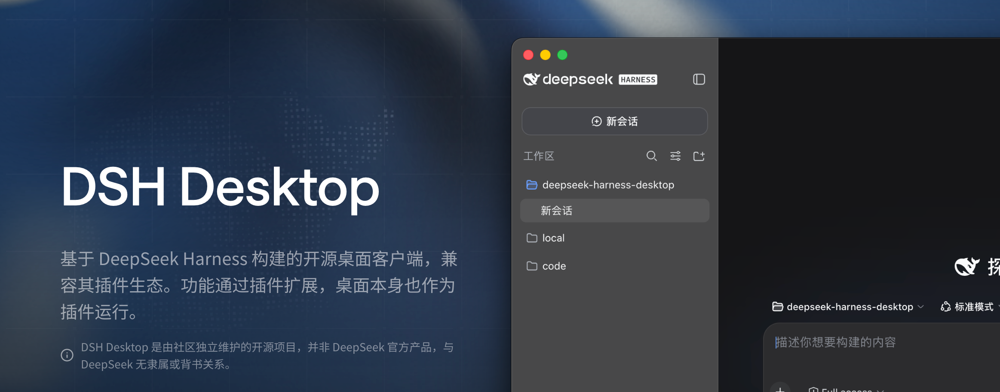
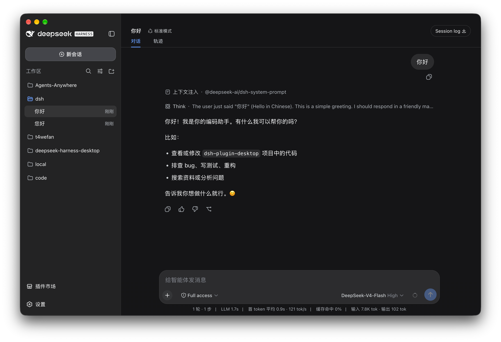

<p align="center">
  <a href="https://omnimux.ai"></a>
</p>

<h1 align="center">OmniMux Desktop</h1>

<p align="center">
  <strong>属于你的内容电商团队 — 一套内容电商系统，让商品卖点贯穿每一次出片。用你熟悉的 Agent，一站式搞定广告、电商与种草视频。</strong>
</p>

<h3 align="center"><a href="https://omnimux.ai">一键下载，开箱即用。</a></h3>

<p align="center">
  把商品和创意交给桌面端 Agent，在一个本地工作区跑通「对标 → 拆解 → 制作 → 发布 → 复盘」内容电商全链路。<br>
  万物皆「插件」，桌面本身也是「插件」。
</p>

<p align="center"><sub>独立的开源桌面项目，与深度求索（DeepSeek）不存在隶属、合作、授权或背书关系。<br>本仓库目前无深度求索员工或 DeepSeek Harness 上游官方团队成员参与；GitHub Contributors 中显示的上游贡献者来自 fork 继承和同步的提交历史。<br>中文 · <a href="README.en.md">English</a></sub></p>

<p align="center">
  
</p>

<p align="center">
  <a href="https://omnimux.ai"></a>
  <a href="https://github.com/omnimux-ai/omnimux-desktop/releases/latest"></a>
  <a href="https://github.com/omnimux-ai/omnimux-desktop"></a>
  <a href="LICENSE"></a>
  <a href="https://discord.gg/omnimux"></a>
  
</p>

**OmniMux Desktop** 是面向内容电商卖家与创作者的原生桌面工作台（支持 macOS Universal 与 Windows x64），基于开源的 [DeepSeek Harness](https://github.com/deepseek-ai/deepseek-harness)、[DSH Desktop](https://github.com/anywhere-labs/deepseek-harness-desktop) 与 [Cordis](https://github.com/cordiverse/cordis) 插件架构构建。项目固定并原样运行特定上游版本；OmniMux Desktop 提供窗口、托盘、终端、更新和工作配置，并通过 Cordis 插件机制将内容电商工作流与上游 Agent 能力组合进同一个本地运行时。

### 核心内容电商链路

把商品和创意交给桌面端 Agent，在一个本地工作区跑通 **对标 → 拆解 → 制作 → 发布 → 复盘** 闭环：

- **商品与资产中枢**：内置商品库、AI 角色与多角度资产库，让核心商品卖点与品牌视觉资产贯穿每一次出片。
- **爆款对标与灵感拆解**：拆解高转化广告、带货视频与种草脚本结构，提炼可复用的黄金前 3 秒 Hook、分镜节奏与卖点话术。
- **无限画布与时间轴剪辑**：结合无限画布（Canvas）多模态生成工作流与时间轴视频剪辑，一站式完成脚本、配音、出图、分镜视频与成片组装。
- **多平台排期与复盘**：内置面向 TikTok、Instagram、Facebook、YouTube 的排期与发布中心，持续追踪内容表现并反哺下一轮创作。

### OmniMux 开源生态矩阵

| 仓库 | 定位 |
| --- | --- |
| [`omnimux-ai/omnimux-desktop`](https://github.com/omnimux-ai/omnimux-desktop) | **OmniMux Desktop** 桌面工作台（本仓库）：macOS Universal 与 Windows x64 原生宿主、窗口与托盘集成、打包与分发 |
| [`omnimux-ai/omnimux-dsh`](https://github.com/omnimux-ai/omnimux-dsh) | **OmniMux DSH 插件集**：内容电商工作台、商品与资产库、画布工作流、时间轴剪辑与社媒发布插件 |
| [`omnimux-ai/omnimux-gateway`](https://github.com/omnimux-ai/omnimux-gateway) | **OmniMux Gateway**：多模态模型路由、视频生成任务编排、账号与计费网关服务 |

<a id="run"></a>

## 下载与安装

当前正式安装包支持 Windows x64 和 macOS Universal（Intel 与 Apple Silicon）。官方网站为 [https://omnimux.ai](https://omnimux.ai)，安装包唯一官方下载源为 `https://dl.omnimux.ai`——无需额外配置 Node.js 或命令行环境，下载安装即可一键启动。

| 平台 | 官方下载（`dl.omnimux.ai`） | 安装方式 |
| --- | --- | --- |
| macOS Universal | [下载 `OmniMux-universal.dmg`](https://dl.omnimux.ai/releases/latest/OmniMux-universal.dmg) | 打开 DMG，将 OmniMux 拖入 Applications |
| Windows x64 | [下载 `OmniMux-Setup.exe`](https://dl.omnimux.ai/releases/latest/OmniMux-Setup.exe) | 运行 NSIS 安装程序并按提示完成安装 |

详细步骤、插件命令和故障排查见[用户指南](docs/user-guide.md)与[常见问题](docs/faq.md)。

我们希望和所有插件作者一起，构建一个开放、可组合、可持续的 DSH 插件生态，让每个插件都能与其他插件共同进步：[DSH 插件生态倡议书](docs/plugin-ecosystem.md)。

## 文档

普通用户从[用户指南](docs/user-guide.md)开始即可；开发者文档只在需要扩展或维护时才需要阅读。

### 用户文档

| 目标 | 入口 |
| --- | --- |
| 安装和日常使用 | [用户指南](docs/user-guide.md) |
| 快速确认平台、环境和使用边界 | [常见问题](docs/faq.md) |
| 了解数据处理与隐私选择 | [隐私政策](PRIVACY.zh.md) |
| 了解项目为什么存在 | [为什么做 Desktop](docs/why-desktop.md) |
| 查看全部文档与 README 分工 | [文档索引](docs/README.md) |

### 开发者与维护者文档

| 目标 | 入口 |
| --- | --- |
| 阅读插件生态倡议书 | [插件生态倡议书](docs/plugin-ecosystem.md) |
| 编写普通或 Desktop 插件 | [插件开发](docs/plugin-development.md) |
| 参与统一插件 contract 讨论 | [DSH Community Fabric Draft](dsh-community-fabric/README.zh.md) |
| 了解统一插件框架为什么这样设计 | [成熟框架与真实插件调研](dsh-community-fabric/docs/research/mature-plugin-frameworks.zh.md) |
| 查看插件市场的产品与安全设计 | [DSH Community Market](dsh-community-market/README.zh.md) |
| 了解桌面插件可以使用的能力 | [桌面插件接口说明](dsh-plugin-desktop/docs/plugin-services.zh.md) |
| 了解桌面应用如何工作 | [架构说明](docs/architecture.md) |
| 查阅包级构建与发布细节 | [`dsh-plugin-desktop/README.md`](dsh-plugin-desktop/README.md) |

## 主要功能

<table>
  <tr>
    <td width="50%" valign="top">
      <h3>内容电商桌面工作台</h3>
      <p>把上游 DeepSeek Harness 的本地 Web UI 与 OmniMux 内容电商套件带到原生桌面。应用自动启动和管理本地 Harness 服务，集成商品库、AI 角色资产库、无限画布、视频时间轴剪辑与多平台发布中心，无需安装 Node.js 或执行命令。</p>
    </td>
    <td width="50%" valign="top">
      <h3><a href="https://www.agents-anywhere.com">手机远程控制</a> </h3>
      <p>通过 iOS 和 Android 远程连接 Desktop，在手机上发起任务、查看 Agent 出片与工作流进度，并在需要时继续跟进。已在 2.0.9 及以上版本中内置。</p>
    </td>
  </tr>
  <tr>
    <td width="50%" valign="top">
      <h3><a href="dsh-community-market/README.zh.md">插件市场</a> </h3>
      <p>DSH Community Market 已完成并内置，提供插件发现、详情、安装与管理。市场以开放方式连接各种插件数据源：任何人都可以提供、接入和使用符合公开 Schema 的来源，已有 API 也可以通过受审 adapter 加入合作数据源。</p>
    </td>
    <td width="50%" valign="top">
      <h3>共建插件生态</h3>
      <p>DSH 的插件生态由社区共同建设。上游插件、OmniMux 内容电商插件、Desktop 插件和其他社区插件遵循统一的约定，可以通过相同的组合机制共同工作；欢迎加入共建，详见 <a href="docs/plugin-ecosystem.md">DSH 插件生态倡议书</a>。</p>
    </td>
  </tr>
</table>

### 首次设置、浏览器与局域网访问

每个尚未初始化的 profile 正常首次启动时，会先显示由 Desktop 自己提供的原生 Setup Wizard。它可以设置窗口模式与系统材质、插件市场、通知、是否用系统默认浏览器自动打开，以及 Web 访问范围；也可以直接跳过。向导完成或跳过以前，Host 和主窗口都不会启动。完成或跳过状态按 profile 分别记录；显式恢复启动仍优先进入恢复助手。

Web 服务默认仅监听本机回环地址。开启“用浏览器打开”后，Desktop 会在 Web 服务实际就绪时交给系统默认浏览器打开；这个选项不会改变网络暴露范围。“桌面设置”会在选项下显示实际的本机 URL。局域网访问是一个独立的可选设置，开启后还会显示当前可用的局域网 URL。

> **危险：** 向局域网开放不提供鉴权；所有与你处于同一局域网的人都能直接打开 DSH 并操作你的电脑。请只在完全信任的网络中谨慎开启。

自动更新的固定版本检查请求会在 `X-DSH-Desktop-Version` header 中携带当前安装版本，并在 `X-DSH-Desktop-Installation-Id` header 中携带一个由本机生成并持久保存的随机 UUID；它不是从硬件信息推导出的标识。安装包下载请求及其下载重定向不会携带这些 header。

## 插件生态

插件是给 DSH 添加能力的扩展包——模型、工具、界面、内容电商工作流都可以做成插件，像搭积木一样自由组合。

OmniMux Desktop 没有修改上游 DeepSeek Harness 源码，也不是一个固定写死的外壳。固定版本的上游 DeepSeek Harness 原样运行；桌面壳本身——窗口、托盘、终端、更新、工作配置——以及 OmniMux 内容电商套件均作为 DSH 插件接入，并通过 DeepSeek Harness 提供的 Cordis 插件机制与上游能力组合进同一个运行时。从核心 agent 到桌面外壳，整个产品遵守同一条"一切皆插件"的规则：与所固定上游版本兼容的插件可以使用，桌面能力也按插件的方式组合、替换和演进。

我们希望插件生态像手机应用一样：每个插件按同一套规则开发，装在一起也能一起工作、互不干扰。

### 给开发者

与许多其他项目不同，这个项目本身就是一个 DSH [插件](docs/plugin-development.md)：桌面壳与第三方插件使用相同的插件组合机制。Desktop 的插件能力已经可以使用。我们提供了 Desktop 服务，让插件开发者能够把插件与桌面能力集成起来：例如查看和切换工作配置，或在当前配置中安装、更新和移除插件。完整用法见[桌面插件接口说明](dsh-plugin-desktop/docs/plugin-services.zh.md)。为什么选择这样的边界、哪些能力不会暴露给第三方插件，见[为什么做 Desktop](docs/why-desktop.md)和[插件开发指南](docs/plugin-development.md)。

## 与 DeepSeek Harness 及 DSH Desktop 的关系

OmniMux Desktop 是基于 [DeepSeek Harness](https://github.com/deepseek-ai/deepseek-harness)、[DSH Desktop](https://github.com/anywhere-labs/deepseek-harness-desktop) 和 [Cordis](https://github.com/cordiverse/cordis) 插件架构构建的独立开源桌面项目，致力于为内容电商卖家与创作者打造「属于你的内容电商团队」一站式桌面工作台。

本仓库由社区与 OmniMux 团队独立维护，目前不存在深度求索员工或 DeepSeek Harness 上游官方团队成员参与本项目开发、维护或治理的情形。GitHub Contributors 页面中可能出现的上游贡献者，来自本仓库 fork 时继承及后续同步的上游提交历史；该署名仅反映提交来源，不代表相关人员参与本仓库，也不构成任何隶属、合作、授权或背书关系。

上游 DeepSeek Harness 提供核心的智能体能力、插件系统和 Web UI；上游 DSH Desktop 与 OmniMux Desktop 主要负责：

- 原生桌面应用封装与 OmniMux 内容电商预置工作区组装
- 本地服务的启动、停止与恢复
- 桌面窗口和系统托盘集成
- macOS Universal、Windows x64 安装包构建与 `dl.omnimux.ai` 分发
- 更适合桌面与内容电商创作使用的界面体验

如果你希望通过命令行运行 DeepSeek Harness，或者参与其核心功能开发，请优先查看上游仓库。

## 特别感谢

特别感谢 [DeepSeek Harness 原始仓库](https://github.com/deepseek-ai/deepseek-harness) 和 DeepSeek AI 团队。OmniMux Desktop 基于固定版本的上游源码构建，核心的智能体、模型、工具、会话、Web UI 和插件生态都来自这个项目。

特别感谢 [Anywhere Labs](https://github.com/anywhere-labs) 与 [DSH Desktop](https://github.com/anywhere-labs/deepseek-harness-desktop) 团队在开源桌面壳、插件市场（DSH Community Market）与多端协同（Agents Anywhere）上的卓越工程贡献。

同时感谢 [Cordis](https://github.com/cordiverse/cordis) 项目提供的插件化基础。没有这些开源项目，就不会有 OmniMux Desktop。

也感谢 [Koishi.js](https://koishi.chat/) 项目和社区长期积累的插件化实践、工具与经验，以及所有参与讨论、测试、反馈和插件开发的社区成员。

以及每一个使用、支持和参与共建的你。

<a id="run-from-source"></a>

## 开发

桌面端代码位于 `dsh-plugin-desktop/` 与 `dsh-desktop-next/`，外层仓库使用 Yarn，固定的 `deepseek-harness/` 子模块继续使用自己的 pnpm workspace。从仓库根目录执行：

```sh
git submodule update --init --recursive
corepack yarn install --immutable
corepack yarn dev
```

headless 检查使用 `corepack yarn check`；完整的构建、测试和发布边界见[架构说明](docs/architecture.md)和包级 [`README`](dsh-plugin-desktop/README.md)。如何参与贡献见 [CONTRIBUTING.md](CONTRIBUTING.md)。

### macOS 麦克风权限

Stable、Beta、Next 的主应用和 Electron Helper 签名直接使用固定上游 checkout 中的
`deepseek-harness/apps/desktop/scripts/macos-entitlements.plist`。更新子模块版本后，打包会自动使用对应的权限文件，无需维护本地副本；打包前须初始化子模块。各版本的 macOS 配置保留产品自己的麦克风用途说明。

语音输入沿用上游录音流程触发系统授权，语音插件旁不再提供额外权限按钮，Stable/Beta 也不再安装麦克风权限请求桥接或拦截器。

## 社区与链接

- 官方网站：[https://omnimux.ai](https://omnimux.ai)
- 官方下载源：[https://dl.omnimux.ai](https://dl.omnimux.ai)
- GitHub 仓库：[omnimux-ai/omnimux-desktop](https://github.com/omnimux-ai/omnimux-desktop) · [omnimux-ai/omnimux-dsh](https://github.com/omnimux-ai/omnimux-dsh) · [omnimux-ai/omnimux-gateway](https://github.com/omnimux-ai/omnimux-gateway)
- Discord 社区：[加入 OmniMux Discord](https://discord.gg/omnimux)

### 友情链接（DeepSeek Harness 生态）

这里收录 DeepSeek Harness 生态项目及开发者工具。

| 项目 | 简介 | 链接 |
| --- | --- | --- |
| DSH Desktop | 基于 DeepSeek Harness 构建的 Windows 和 macOS 开源桌面客户端（本项目上游桌面基座）。 | [GitHub](https://github.com/anywhere-labs/deepseek-harness-desktop) |
| dshfind | DeepSeek Harness（DSH）学习与分享社区。 | [GitHub](https://github.com/hikariming/dshfind) · [官网](https://dshfind.com) |
| DSH 1024Store | 面向 DeepSeek Harness（dsh）生态的社区插件目录，开源了在线插件市场、目录流水线与公开查询 API。 | [GitHub](https://github.com/imsai-sh/awesome-deepseek-harness-plugins) |
| Awesome DSH Plugin | DeepSeek Harness（DSH）插件精选列表。 | [GitHub](https://github.com/awesome-dsh-plugin/awesome-dsh-plugin) |
| dsh-market | DeepSeek Harness 内的可视化插件市场，支持浏览、搜索与一键安装插件。 | [GitHub](https://github.com/dsh-market/dsh-market) |
| ModLens | 为 DeepSeek Harness 和纯文本 Coding Agent 提供 OCR、版面与语义识别能力。 | [GitHub](https://github.com/liustack/modlens) · [官网](https://liustack.dev) |
| DeepSeek Harness 橙皮书 | DeepSeek Harness 社区实测手册。 | [GitHub](https://github.com/alchaincyf/deepseek-harness-orange-book) |
| dsh-web-ui | DeepSeek Harness Web UI 插件与皮肤合集。 | [GitHub](https://github.com/zhu1090093659/dsh-web-ui) · [展示站](https://gallery.dsh-market.com) |
| dsh-TUI | DeepSeek Harness 全屏交互式终端界面。 | [GitHub](https://github.com/ccch1mneyyy/dsh-TUI) |
| dsh-tianshu-tui | DSH Web 端交互式终端极简风格 UI 插件，自研 ANSI 渲染核心。 | [GitHub](https://github.com/huiliyi37/dsh-tianshu-tui) |
| dsh-context | DSH 上下文洞察面板：Context 仪表盘 + `/context` 命令 + Context 浏览器。 | [GitHub](https://github.com/bowenliang123/dsh-context) · [NPM](https://www.npmjs.com/package/dsh-context) |
| Agents-Anywhere | 从手机远程控制电脑上的 Coding Agent。 | [GitHub](https://github.com/anywhere-labs/Agents-Anywhere) |
| deepseek-harness-remote | 基于 P2P 与 APIProxy 的 DeepSeek Harness 远程控制与多端协同插件。 | [GitHub](https://github.com/liguobao/deepseek-harness-remote) |
| DSH-better-sidebar | DeepSeek Harness 侧边栏工作台，集成文件、终端、Git 和子代理。 | [GitHub](https://github.com/omdsh-dev/DSH-better-sidebar) |
| Awesome DeepSeek Harness | DeepSeek Harness 插件、工具与基础设施精选列表。 | [GitHub](https://github.com/0xsline/awesome-deepseek-harness) · [官网](https://deepseekdocs.com/) |

## License

本仓库中继承自上游 DSH Desktop / DeepSeek Harness 的代码保留 [MIT License](LICENSE)；OmniMux 自研组件与产品集成遵循 AGPL-3.0 许可。

> “DeepSeek Harness”是深度求索公司的注册商标。本文仅为准确说明兼容性、技术来源及与上游软件的关系而使用该名称。

> OmniMux Desktop 与 DSH Desktop 均是独立的开源项目，与深度求索（DeepSeek）不存在隶属、合作、授权或背书关系。
